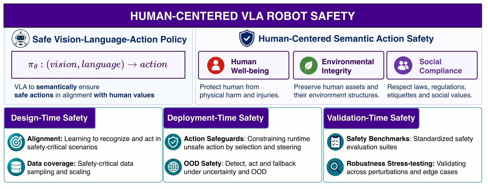
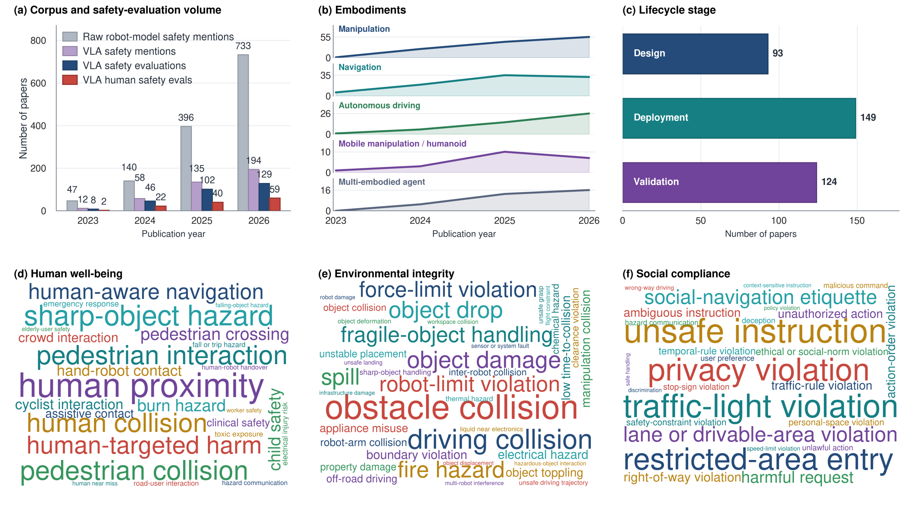
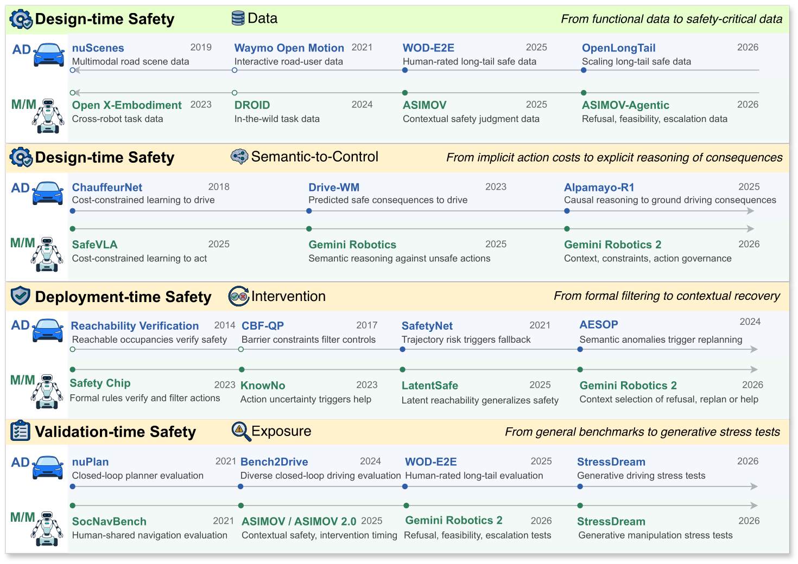
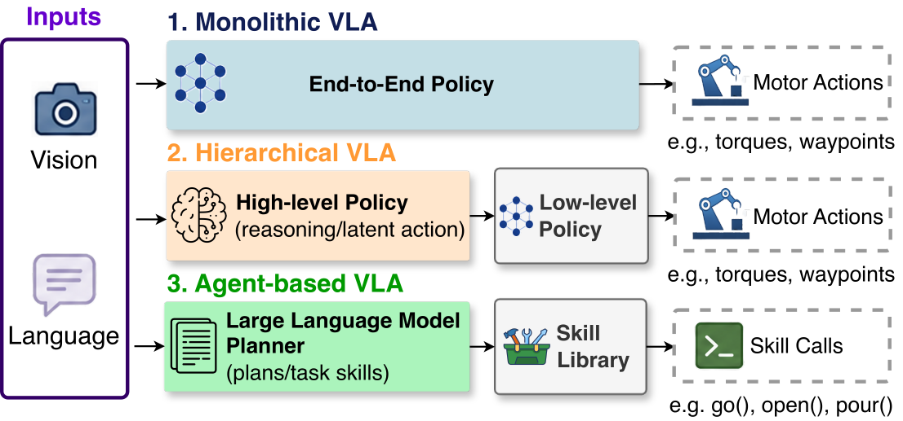
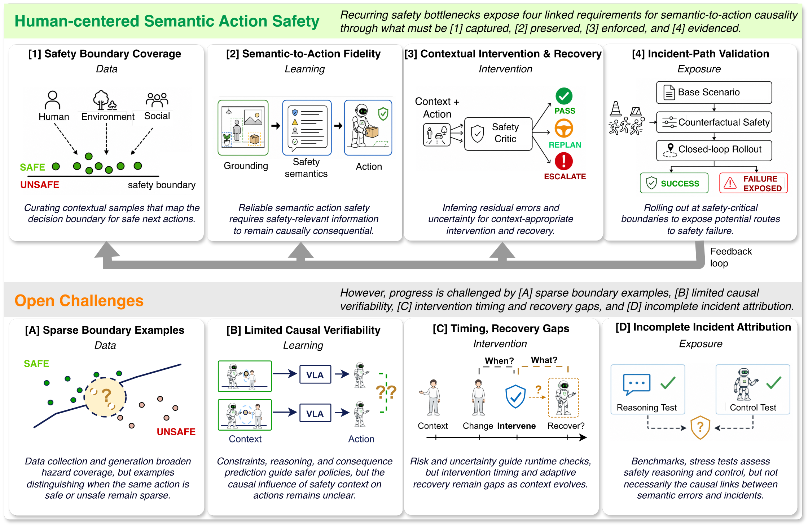

# 🤖 Towards Human-Centered Safety in Vision-Language-Action Robot Control

### 📝 A Survey and Outlook

Nhat Chung1,2,\*, Toan Nguyen3,\*, Tianrun Hu1, Yun Xing4, Puming Jiang1, Tuan-Anh Vu5, Bohao Qu2, 
Yedi Zhang1, Yue Cao7, Jie Zhang2, Qing Guo1,6,†, Yue Wang3, Ming-Ming Cheng6, 
Jin Song Dong1, Cheston Tan2, Harold Soh1, David Hsu1, Daniel Seita3, Ivor Tsang2,7

1National University of Singapore · 2IAIC, A*STAR · 3University of Southern California 
4University of Alberta · 5University of California, Los Angeles · 6Nankai University 
7Nanyang Technological University

*Equal contributions · †Corresponding author

**A curated reading list for semantic action safety in embodied AI**

[🧭 Taxonomy](#taxonomy-at-a-glance) · [📄 Paper List](#surveyed-papers) · [📚 Related Papers](#related-papers) · [🧪 Replication](#replication) · [🤝 Contributing](#contributing)

---

## 💡 Using This Survey

Choosing a safety approach for a robot starts with understanding what must be protected, in which context, and how that requirement should shape its actions. For example, a household assistant may need to handle hot objects, respect personal preferences, and seek clarification when instructions are ambiguous. This survey helps connect application needs to technical choices through four perspectives:

- **🌍 Safety semantics:** Explore the diversity of safety requirements across human well-being, environmental integrity, and social compliance, including hazards that depend on context, intent, and delayed consequences.
- **📐 Problem formulations:** Compare how safety is represented through learning objectives, explicit constraints, temporal logic, executable predicates, and uncertainty estimates, and examine the assumptions each formulation requires.
- **🛡️ Mitigation methods:** Find approaches spanning safety alignment and data coverage, runtime action filtering and plan verification, human intervention, and recovery, with attention to where each operates in the robot's lifecycle.
- **🔭 Research directions:** Identify gaps in safety boundary coverage, the influence of safety reasoning on actions, intervention timing and recovery, and evaluation that traces how unsafe outcomes arise.

### 🗺️ Figure 1. Human-centered VLA safety taxonomy

### 📊 Figure 2. VLA safety research landscape

The survey's corpus analysis shows where the cited work concentrates across embodiments, lifecycle stages, and human, environmental, and social safety scenarios.

### 🗓️ Figure 3. Research milestones

The survey traces a progression linking safety data, semantic control, runtime intervention, and validation.

## 🔎 Overview

This repository accompanies the survey **“Towards Human-Centered Safety in Vision-Language-Action Robot Control: A Survey and Outlook.”** It organizes research on how vision-language-action (VLA) systems can recognize, reason about, and avoid unsafe behavior throughout the robotics lifecycle.

The collection centers on three complementary stages:

- **🧠 Design time:** learning alignment and scaling safety-critical data.
- **🛡️ Deployment time:** runtime action safeguards and out-of-distribution-aware intervention.
- **✅ Validation time:** safety benchmarks, adversarial and backdoor stress tests, and safety-critical scenarios.

## 📖 Contents

- [🧭 Taxonomy at a Glance](#taxonomy-at-a-glance)
- [📄 Surveyed Papers](#surveyed-papers)
  - [🧠 I. Design-Time Safety](#i-design-time-safety): [🎓 Learning-Based Alignment](#learning-based-alignment) · [🗂️ Safety Data Coverage](#safety-data-coverage)
  - [🛡️ II. Deployment-Time Safety](#ii-deployment-time-safety): [🛡️ Action Safeguards](#action-safeguards) · [🚨 OOD Safety](#ood-safety)
  - [✅ III. Validation-Time Safety](#iii-validation-time-safety): [📊 Safety Benchmarking](#safety-benchmarking) · [🔬 Robustness Stress-Testing](#robustness-stress-testing)
- [📚 Related Papers](#related-papers)
- [🧪 Replication](#replication)
- [🔗 Related Projects](#related-projects)
- [🤝 Contributing](#contributing)

## 🧭 Taxonomy at a Glance

| Lifecycle stage | Core question | Topics |
| --- | --- | --- |
| **🧠 Design time** | How can safety be learned before deployment? | Control and reasoning alignment, world models, safety-critical data |
| **🛡️ Deployment time** | How can unsafe actions be detected or corrected online? | Control and task guardrails, OOD detection and intervention |
| **✅ Validation time** | How can safety claims be evaluated systematically? | Safety benchmarks, adversarial and backdoor testing, safety-critical scenarios |

## 📄 Surveyed Papers

Papers follow the survey’s lifecycle taxonomy and are listed by year, newest first within each table. Expand or collapse the subsections to browse individual topics. Cross-listing is intentional when a paper contributes to multiple categories.

Venue labels follow publisher records, proceedings, or explicit author publication records. Conference years identify the conference edition; journal years identify the cited publication. Entries labeled `arXiv` use the first release year and do not imply peer review. `n.d.` marks an undated web page. Citation metadata was checked on 25 October 2026; the [🔎 reference audit](_replication/reference_audit.csv) records sources and corrections.

### 🧠 I. Design-Time Safety

Learning safe behavior and improving data coverage.

<b>🎓 A. Learning-Based Alignment</b>

<b>⚙️ Direct Control Alignment</b>

These methods characterize reactive control safety strategies typically identified as System 1.

#### 🎓 Imitation-Driven Safety

These methods learn collision avoidance and goal-reaching behavior from demonstrations. ViNT and NoMaD establish broad navigation priors, while NavDP adds safety-oriented trajectory data and a learned critic. Their strength is scalable reactive control; their limitation is that safety remains bounded by what demonstrations cover.

| 📅 Year | 🏛️ Venue | 📄 Paper |
| --- | --- | --- |
| 2026 | ICRA | [NavDP: Learning Sim-to-Real Navigation Diffusion Policy with Privileged Information Guidance](https://arxiv.org/abs/2505.08712) ↗ |
| 2024 | ICRA | [NoMaD: Goal Masked Diffusion Policies for Navigation and Exploration](https://arxiv.org/abs/2310.07896) ↗ |
| 2023 | CoRL | [ViNT: A Foundation Model for Visual Navigation](https://arxiv.org/abs/2306.14846) ↗ |

#### ⚙️ Control-Constrained Safety

Control-constrained methods introduce explicit penalties, rewards, or intervention signals during learning. They move beyond passive imitation by teaching policies to avoid collisions, respect human proximity, and recover from unsafe states, although the learned constraint is only as reliable as its reward and training coverage.

| 📅 Year | 🏛️ Venue | 📄 Paper |
| --- | --- | --- |
| 2026 | ICLR | [From Seeing to Experiencing: Scaling Navigation Foundation Models with Reinforcement Learning](https://arxiv.org/abs/2507.22028) ↗ |
| 2025 | NeurIPS Spotlight | [SafeVLA: Towards Safety Alignment of Vision-Language-Action Model via Constrained Learning](https://arxiv.org/abs/2503.03480) ↗ |
| 2023 | TPAMI | [Human-Guided Reinforcement Learning With Sim-to-Real Transfer for Autonomous Navigation](https://doi.org/10.1109/TPAMI.2023.3314762) ↗ |

<b>💭 Reasoning-Augmented Control Alignment</b>

These models augment reactive (System 1) policies with reasoning (System 2) to infer actions based on safety factors and/or predicted outcomes.

#### 💭 Reasoning-Mediated Safety

This line of work makes safety-relevant semantics explicit in intermediate reasoning. Driving models ground traffic objects, rules, styles, and possible hazards, while manipulation and navigation models use feasibility reasoning to reject unsafe actions. Explicit reasoning improves interpretability, but plausible explanations do not by themselves guarantee safe control.

| 📅 Year | 🏛️ Venue | 📄 Paper |
| --- | --- | --- |
| 2026 | arXiv | [StyleVLA: Driving Style-Aware Vision Language Action Model for Autonomous Driving](https://arxiv.org/abs/2603.09482) ↗ |
| 2026 | arXiv | [SpanVLA: Learning from Negative-Recovery Samples with Fast Action Bridging for Vision-Language-Action Model](https://arxiv.org/abs/2604.19710) ↗ |
| 2026 | RSS | [Self-Supervised Bootstrapping of Action-Predictive Embodied Reasoning](https://arxiv.org/abs/2602.08167) ↗ |
| 2026 | ICML | [TIC-VLA: A Think-in-Control Vision-Language-Action Model for Robot Navigation in Dynamic Environments](https://arxiv.org/abs/2602.02459) ↗ |
| 2026 | IEEE/ASME Transactions on Mechatronics | [A Dual-System Vision-Language-Action Model for Rational Manipulation](https://doi.org/10.1109/TMECH.2026.3658581) ↗ |
| 2026 | arXiv | [Do Vision-Language-Action Models Mean What They Say? On the Role of Faithfulness in Embodied Reasoning](https://arxiv.org/abs/2607.04681) ↗ |
| 2025 | NeurIPS | [AutoVLA: A Vision-Language-Action Model for End-to-End Autonomous Driving with Adaptive Reasoning and Reinforcement Fine-Tuning](https://arxiv.org/abs/2506.13757) ↗ |
| 2025 | arXiv | [Poutine: Vision-Language-Trajectory Pre-Training and Reinforcement Learning Post-Training Enable Robust End-to-End Autonomous Driving](https://arxiv.org/abs/2506.11234) ↗ |
| 2025 | arXiv | [Gemini Robotics: Bringing AI into the Physical World](https://arxiv.org/abs/2503.20020) ↗ |
| 2024 | CoRL | [Tokenize the World into Object-level Knowledge to Address Long-tail Events in Autonomous Driving](https://arxiv.org/abs/2407.00959) ↗ |

#### 🌐 World-Model-Based Safety

World-model approaches train policies against predicted consequences rather than only immediate actions. Failure data, takeover boundaries, counterfactuals, and latent rollouts help models anticipate collisions and recovery needs. Their central bottleneck is prediction fidelity: an imagined future can only support safety when it preserves the relevant physics and semantics.

| 📅 Year | 🏛️ Venue | 📄 Paper |
| --- | --- | --- |
| 2026 | arXiv | [Unleashing VLA Potentials in Autonomous Driving via Explicit Learning from Failures](https://arxiv.org/abs/2603.01063) ↗ |
| 2026 | arXiv | [Learning from Mistakes: Post-Training for Driving VLA with Takeover Data](https://arxiv.org/abs/2603.14972) ↗ |
| 2026 | CVPR Findings | [Devil is in Narrow Policy: Unleashing Exploration in Driving VLA Models](https://arxiv.org/abs/2603.06049) ↗ |
| 2026 | CVPR | [Counterfactual VLA: Self-Reflective Vision-Language-Action Model with Adaptive Reasoning](https://arxiv.org/abs/2512.24426) ↗ |
| 2025 | arXiv | [IRL-VLA: Training an Vision-Language-Action Policy via Reward World Model](https://arxiv.org/abs/2508.06571) ↗ |
| 2024 | ECCV | [Think2Drive: Efficient Reinforcement Learning by Thinking in Latent World Model for Quasi-Realistic Autonomous Driving (in CARLA-v2)](https://arxiv.org/abs/2402.16720) ↗ |

#### 🧩 Hybrid Safety

Hybrid methods couple structured reasoning with learned control scores or world models. This combination can connect causal explanations to trajectory selection, but errors may still propagate across the reasoning-to-control interface.

| 📅 Year | 🏛️ Venue | 📄 Paper |
| --- | --- | --- |
| 2026 | CVPR | [Latent Chain-of-Thought World Modeling for End-to-End Driving](https://arxiv.org/abs/2512.10226) ↗ |
| 2025 | arXiv | [Alpamayo-R1: Bridging Reasoning and Action Prediction for Generalizable Autonomous Driving in the Long Tail](https://arxiv.org/abs/2511.00088) ↗ |

<b>🤖 Agentic Action Alignment</b>

These models rely on safety-aligned LLMs or VLMs to select and sequence actions through planners or action APIs that directly interface with robotic systems, enabling agentic System 2 control.

**⚠️ Risks**

| 📅 Year | 🏛️ Venue | 📄 Paper |
| --- | --- | --- |
| 2026 | CVPR | [AGENTSAFE: Benchmarking the Safety of Embodied Agents on Hazardous Instructions](https://arxiv.org/abs/2506.14697) ↗ |
| 2025 | ICRA | [Jailbreaking LLM-Controlled Robots](https://arxiv.org/abs/2410.13691) ↗ |
| 2025 | ICLR | [BadRobot: Jailbreaking Embodied LLM Agents in the Physical World](https://arxiv.org/abs/2407.20242) ↗ |

**🛡️ Alignment and defenses**

Agentic alignment primarily inherits refusal and safety-reasoning capabilities from the underlying multimodal model. Constitutions and physical-danger benchmarks improve high-level judgment, yet reliable deployment still requires verifying that safe reasoning is translated into safe tool calls and robot actions.

| 📅 Year | 🏛️ Venue | 📄 Paper |
| --- | --- | --- |
| 2025 | arXiv | [Generating Robot Constitutions & Benchmarks for Semantic Safety](https://arxiv.org/abs/2503.08663) ↗ |
| 2025 | arXiv | [Can AI Perceive Physical Danger and Intervene?](https://arxiv.org/abs/2509.21651) ↗ |
| 2024 | ICML | [HarmBench: A Standardized Evaluation Framework for Automated Red Teaming and Robust Refusal](https://arxiv.org/abs/2402.04249) ↗ |

<b>🗂️ B. Safety Data Coverage</b>

<b>🎯 Safety-Critical Scenario Sampling</b>

Sampling methods concentrate limited training and evaluation budgets on rare, diverse, or high-impact events. They improve efficiency near the safety boundary, but cannot recover hazards that were never observed or reliably represented in deployment logs.

| 📅 Year | 🏛️ Venue | 📄 Paper |
| --- | --- | --- |
| 2026 | CVPR | [Scaling-Aware Data Selection for End-to-End Autonomous Driving Systems](https://arxiv.org/abs/2604.08366) ↗ |
| 2026 | IROS | [Unsupervised Discovery of Failure Taxonomies from Deployment Logs](https://arxiv.org/abs/2506.06570) ↗ |
| 2025 | KDD | [SSE: Multimodal Semantic Data Selection and Enrichment for Industrial-scale Data Assimilation](https://arxiv.org/abs/2409.13860) ↗ |

<b>🎬 Safety-Critical Data Generation</b>

Generation methods create failures and long-tail hazards that are costly or unsafe to collect in the real world. Scripted simulation offers control, while neural world models offer scale and diversity; both depend on whether the generated scenarios preserve the causal factors that make real behavior unsafe.

Simulation-based strategies collect data through scripted motions:

| 📅 Year | 🏛️ Venue | 📄 Paper |
| --- | --- | --- |
| 2026 | ICRA | [NavDP: Learning Sim-to-Real Navigation Diffusion Policy with Privileged Information Guidance](https://arxiv.org/abs/2505.08712) ↗ |
| 2026 | IROS | [FailSafe: Reasoning and Recovery from Failures in Vision-Language-Action Models](https://arxiv.org/abs/2510.01642) ↗ |
| 2024 | CoRL | [Avoid Everything: Model-Free Collision Avoidance with Expert-Guided Fine-Tuning](https://proceedings.mlr.press/v270/fishman25a.html) ↗ |

Other methods construct augmented environments that expose models to rare but physically plausible hazards through neural world modeling:

| 📅 Year | 🏛️ Venue | 📄 Paper |
| --- | --- | --- |
| 2026 | arXiv | [OpenLongTail: Generative Scaling of Long-Tail Driving Data](https://arxiv.org/abs/2607.09655) ↗ |
| 2025 | arXiv | [GAIA-2: A Controllable Multi-View Generative World Model for Autonomous Driving](https://arxiv.org/abs/2503.20523) ↗ |
| 2025 | arXiv | [Cosmos-Transfer1: Conditional World Generation with Adaptive Multimodal Control](https://arxiv.org/abs/2503.14492) ↗ |
| 2025 | arXiv | [Evaluating Gemini Robotics Policies in a Veo World Simulator](https://arxiv.org/abs/2512.10675) ↗ |
| 2023 | arXiv | [GAIA-1: A Generative World Model for Autonomous Driving](https://arxiv.org/abs/2309.17080) ↗ |

---

### 🛡️ II. Deployment-Time Safety

Monitoring, filtering, and intervention at runtime.

<b>🛡️ A. Action Safeguards</b>

<b>🦾 1. Control-Level Safeguards</b>

These safety filters check predicted robot controls against explicit constraints, apply corrections when needed, and select safely executable actions.

<b>📐 a. Control-Theoretic Filtering</b>

#### 📐 Reachability-Based Filters

Reachability filters ask whether a proposed goal, trajectory, or action can remain inside a safe set. The papers progress from geometric collision avoidance toward latent and runtime-parameterized safety concepts, trading stronger coverage for greater dependence on learned state representations.

| 📅 Year | 🏛️ Venue | 📄 Paper |
| --- | --- | --- |
| 2026 | ICRA | [From Demonstrations to Safe Deployment: Path-Consistent Safety Filtering for Diffusion Policies](https://arxiv.org/abs/2511.06385) ↗ |
| 2026 | ICRA | [AnySafe: Adapting Latent Safety Filters at Runtime via Safety Constraint Parameterization in the Latent Space](https://arxiv.org/abs/2509.19555) ↗ |
| 2026 | CoRL | [How Well Do Latent World Models Understand Partially Observable Safety Constraints?](https://arxiv.org/abs/2510.06492) ↗ |
| 2025 | IROS | [Robots That Suggest Safe Alternatives](https://arxiv.org/abs/2409.09883) ↗ |
| 2025 | RSS | [Generalizing Safety Beyond Collision-Avoidance via Latent-Space Reachability Analysis](https://arxiv.org/abs/2502.00935) ↗ |
| 2025 | CoRL | [Uncertainty-aware Latent Safety Filters for Avoiding Out-of-Distribution Failures](https://arxiv.org/abs/2505.00779) ↗ |

#### 🚧 Control-Barrier Function Filters

Control-barrier methods convert grounded hazards into local action constraints and minimally modify unsafe commands. They are efficient enough for step-level intervention, but contextual or hidden hazards must first be detected and expressed in a control-compatible form.

| 📅 Year | 🏛️ Venue | 📄 Paper |
| --- | --- | --- |
| 2026 | IROS | [VLSA: Vision-Language-Action Models with Plug-and-Play Safety Constraint Layer](https://arxiv.org/abs/2512.11891) ↗ |
| 2026 | IROS | [Safe-Night VLA: Seeing the Unseen via Thermal-Perceptive Vision-Language-Action Models for Safety-Critical Manipulation](https://arxiv.org/abs/2603.05754) ↗ Handles perceptual blind spots—such as hot objects and reflections—using safety constraints and a runtime safety filter. |
| 2026 | arXiv | [Contextual Safety Reasoning and Grounding for Open-World Robots](https://arxiv.org/abs/2602.19983) ↗ |

<b>🧭 b. Guided Action Generation</b>

These methods guide diffusion or flow-based action generation with symbolic constraints, learned critics, or streaming feedback.

| 📅 Year | 🏛️ Venue | 📄 Paper |
| --- | --- | --- |
| 2026 | arXiv | [Neuro-Symbolic Safety Guidance for Vision-Language-Action Models via Constrained Flow Matching](https://arxiv.org/abs/2607.01378) ↗ |
| 2026 | arXiv | [Guided Action Flow: Value-Guided Sampling for Frozen Vision-Language-Action Policies](https://arxiv.org/abs/2607.02092) ↗ |
| 2026 | RSS | [Guided Streaming Stochastic Interpolant Policy](https://arxiv.org/abs/2605.10051) ↗ |
| 2024 | IEEE Robotics and Automation Letters | [LTLDoG: Satisfying Temporally-Extended Symbolic Constraints for Safe Diffusion-Based Planning](https://arxiv.org/abs/2405.04235) ↗ |

<b>🔮 c. Predictive Filtering</b>

#### 📈 Value Estimation

Value-based filters sample candidate futures and select the one with the best predicted safety and task outcome. This supports geometric, semantic, and social criteria, although it cannot reject an unsafe outcome that is neither sampled nor recognized by the evaluator.

| 📅 Year | 🏛️ Venue | 📄 Paper |
| --- | --- | --- |
| 2026 | ICRA | [Do What You Say: Steering Vision-Language-Action Models via Runtime Reasoning-Action Alignment Verification](https://arxiv.org/abs/2510.16281) ↗ |
| 2026 | ICRA | [NavDP: Learning Sim-to-Real Navigation Diffusion Policy with Privileged Information Guidance](https://arxiv.org/abs/2505.08712) ↗ |
| 2026 | IEEE Robotics and Automation Letters | [From Obstacles to Etiquette: Robot Social Navigation with VLM-Informed Path Selection](https://arxiv.org/abs/2602.09002) ↗ |

#### 🌐 Neural World Modeling

These methods evaluate imagined rollouts before execution. They broaden filtering to delayed and semantic consequences, but hallucinated objects, missing interactions, or inaccurate dynamics can undermine the safety judgment.

| 📅 Year | 🏛️ Venue | 📄 Paper |
| --- | --- | --- |
| 2026 | ICRA | [Reimagination with Test-time Observation Interventions: Distractor-Robust World Model Predictions for Visual Model Predictive Control](https://arxiv.org/abs/2506.16565) ↗ |
| 2025 | arXiv | [From Foresight to Forethought: VLM-in-the-Loop Policy Steering via Latent Alignment](https://arxiv.org/abs/2502.01828) ↗ |
| 2024 | CVPR | [Driving into the Future: Multiview Visual Forecasting and Planning with World Model for Autonomous Driving](https://arxiv.org/abs/2311.17918) ↗ |

### 🤖 Figure 4. VLA paradigms

Control-level filters above act near motor outputs; the task-level guardrails below inspect plans and skill calls. These architectures show where each check enters the action pipeline.

<b>🚧 2. Task-Level Guardrail</b>

Natural-language feedback can also update the safety constraints used to evaluate proposed actions.

| 📅 Year | 🏛️ Venue | 📄 Paper |
| --- | --- | --- |
| 2025 | ICRA | [Updating Robot Safety Representations Online from Natural Language Feedback](https://arxiv.org/abs/2409.14580) ↗ |

#### 📋 Formal Runtime Verification

Runtime-verification methods encode safety as temporal logic, automata, invariants, or executable predicates. Their decisions are inspectable and can trigger blocking or replanning, but open-world safety requirements are difficult to specify and ground completely.

| 📅 Year | 🏛️ Venue | 📄 Paper |
| --- | --- | --- |
| 2026 | AAAI | [IS-Bench: Evaluating Interactive Safety of VLM-Driven Embodied Agents in Daily Household Tasks](https://arxiv.org/abs/2506.16402) ↗ |
| 2026 | IEEE Robotics and Automation Letters | [Safety Guardrails for LLM-Enabled Robots](https://arxiv.org/abs/2503.07885) ↗ |
| 2026 | ICLR ESR Workshop | [RoboSafe: Safeguarding Embodied Agents via Executable Safety Logic](https://arxiv.org/abs/2512.21220) ↗ |
| 2026 | IROS | [Ask, Reason, Assist: Robot Collaboration via Natural Language and Temporal Logic](https://arxiv.org/abs/2509.23506) ↗ |
| 2025 | NeurIPS | [RvLLM: LLM Runtime Verification with Domain Knowledge](https://arxiv.org/abs/2505.18585) ↗ General LLM runtime verification, evaluated on legal and mathematical tasks. |
| 2025 | ICRA | [SELP: Generating Safe and Efficient Task Plans for Robot Agents with Large Language Models](https://arxiv.org/abs/2409.19471) ↗ |
| 2025 | EMNLP | [Subtle Risks, Critical Failures: A Framework for Diagnosing Physical Safety of LLMs for Embodied Decision Making](https://aclanthology.org/2025.emnlp-main.1305/) ↗ |
| 2025 | arXiv | [SafePlan: Leveraging Formal Logic and Chain-of-Thought Reasoning for Enhanced Safety in LLM-based Robotic Task Planning](https://arxiv.org/abs/2503.06892) ↗ |
| 2024 | SACMAT | [BlueSky: How to Raise a Robot - A Case for Neuro-Symbolic AI in Constrained Task Planning for Humanoid Assistive Robots](https://doi.org/10.1145/3649158.3657034) ↗ |
| 2024 | ICRA | [Plug in the Safety Chip: Enforcing Constraints for LLM-driven Robot Agents](https://arxiv.org/abs/2309.09919) ↗ |
| 2024 | IROS | [Ensuring Safety in LLM-Driven Robotics: A Cross-Layer Sequence Supervision Mechanism](https://doi.org/10.1109/IROS58592.2024.10801576) ↗ |

#### 🔍 Semantic Verification

Semantic verifiers use learned reasoning, affordance checks, constitutions, or predicted consequences when hazards cannot be fully formalized. They cover more contextual risks than fixed rules, while offering weaker guarantees and inheriting the evaluator model's failure modes.

| 📅 Year | 🏛️ Venue | 📄 Paper |
| --- | --- | --- |
| 2026 | CVPR | [AGENTSAFE: Benchmarking the Safety of Embodied Agents on Hazardous Instructions](https://arxiv.org/abs/2506.14697) ↗ |
| 2026 | Google DeepMind technical report | [Gemini Robotics 2: Safety Evaluations](https://storage.googleapis.com/deepmind-media/gemini-robotics/Gemini-Robotics-2-Safety.pdf) ↗ |
| 2025 | IEEE Robotics and Automation Letters | [Don't Let Your Robot Be Harmful: Responsible Robotic Manipulation via Safety-as-Policy](https://arxiv.org/abs/2411.18289) ↗ |
| 2024 | arXiv | [AutoRT: Embodied Foundation Models for Large Scale Orchestration of Robotic Agents](https://arxiv.org/abs/2401.12963) ↗ |

<b>🚨 B. OOD Safety</b>

#### 🚨 Semantic Anomaly Detection

Detection methods treat semantic novelty or uncertainty as evidence that the policy may have left its reliable operating regime. Detection alone is insufficient unless it is connected to a timely fallback, clarification, or human handover.

| 📅 Year | 🏛️ Venue | 📄 Paper |
| --- | --- | --- |
| 2024 | RSS | [Real-Time Anomaly Detection and Reactive Planning with Large Language Models](https://arxiv.org/abs/2407.08735) ↗ |
| 2023 | Autonomous Robots | [Semantic Anomaly Detection with Large Language Models](https://arxiv.org/abs/2305.11307) ↗ |
| 2023 | CoRL | [Robots That Ask for Help: Uncertainty Alignment for Large Language Model Planners](https://arxiv.org/abs/2307.01928) ↗ |

#### 🎯 Uncertainty-Aware Control Prediction

These methods translate uncertainty into action selection, replanning, or deferral. Their shared challenge is calibration: the robot must distinguish harmless novelty from ambiguity, capability mismatch, and imminent physical risk.

| 📅 Year | 🏛️ Venue | 📄 Paper |
| --- | --- | --- |
| 2026 | RSS | [When to Act, Ask, or Learn: Uncertainty-Aware Policy Steering](https://arxiv.org/abs/2602.22474) ↗ |
| 2026 | Google DeepMind technical report | [Gemini Robotics 2: Safety Evaluations](https://storage.googleapis.com/deepmind-media/gemini-robotics/Gemini-Robotics-2-Safety.pdf) ↗ |
| 2025 | CoRL | [Real-Time Out-of-Distribution Failure Prevention via Multi-Modal Reasoning](https://arxiv.org/abs/2505.10547) ↗ |
| 2025 | CoRL | [Uncertainty-Aware Latent Safety Filters for Avoiding Out-of-Distribution Failures](https://arxiv.org/abs/2505.00779) ↗ |

---

### ✅ III. Validation-Time Safety

Benchmarking, stress testing, and safety evidence.

<b>📊 A. Safety Benchmarking</b>

Safety benchmarking separates **control-centric evaluation**, which measures what happens after language and perception are grounded into motion, from **reasoning-centric evaluation**, which asks whether unsafe actions should be proposed at all.

#### 🦾 Control-Centric Evaluation

Control-centric benchmarks expose unsafe trajectories, contact, rule violations, and failures under distribution shift. Their shared contribution is to separate task completion from safety, although metrics beyond collisions and aggregate success remain uneven.

| 📅 Year | 🏛️ Venue | 📄 Paper |
| --- | --- | --- |
| 2026 | RSS | [OopsieVerse: A Safety Benchmark with Damage-Aware Simulation for Robot Manipulation](https://arxiv.org/abs/2606.31993) ↗ |
| 2026 | arXiv | [ACME: A Multi-Cultural, Multi-Embodiment Social-Navigation Dataset](https://arxiv.org/abs/2607.21964) ↗ |
| 2026 | CVPR | [WOD-E2E: Waymo Open Dataset for End-to-End Driving in Challenging Long-Tail Scenarios](https://arxiv.org/abs/2510.26125) ↗ |
| 2026 | arXiv | [Fail2Drive: Benchmarking Closed-Loop Driving Generalization](https://arxiv.org/abs/2604.08535) ↗ |
| 2026 | arXiv | [SidewalkBench: Benchmarking Visual Navigation on Urban Sidewalks](https://arxiv.org/abs/2606.16953) ↗ |
| 2026 | ICML | [TIC-VLA: A Think-in-Control Vision-Language-Action Model for Robot Navigation in Dynamic Environments](https://arxiv.org/abs/2602.02459) ↗ |
| 2026 | ICML | [VLA-Arena: An Open-Source Framework for Benchmarking Vision-Language-Action Models](https://arxiv.org/abs/2512.22539) ↗ |
| 2026 | arXiv | [HazardArena: Evaluating Semantic Safety in Vision-Language-Action Models](https://arxiv.org/abs/2604.12447) ↗ |
| 2026 | ECCV | [LIBERO-Safety: A Comprehensive Benchmark for Physical and Semantic Safety in Vision-Language-Action Models](https://arxiv.org/abs/2606.23686) ↗ |
| 2025 | NeurIPS Spotlight | [SafeVLA: Towards Safety Alignment of Vision-Language-Action Model via Constrained Learning](https://arxiv.org/abs/2503.03480) ↗ |
| 2025 | arXiv | [ANNIE: Be Careful of Your Robots](https://arxiv.org/abs/2509.03383) ↗ |
| 2024 | NeurIPS Datasets and Benchmarks | [Bench2Drive: Towards Multi-Ability Benchmarking of Closed-Loop End-to-End Autonomous Driving](https://arxiv.org/abs/2406.03877) ↗ |
| 2024 | NeurIPS Datasets and Benchmarks | [NAVSIM: Data-Driven Non-Reactive Autonomous Vehicle Simulation and Benchmarking](https://arxiv.org/abs/2406.15349) ↗ |

#### 💭 Reasoning-Centric Evaluation

These benchmarks test hazard understanding, refusal, rule following, and multi-step planning before physical execution. They make semantic failures easier to attribute, but many still represent people mainly as labels or hazards rather than interactive agents with intent and preferences.

| 📅 Year | 🏛️ Venue | 📄 Paper |
| --- | --- | --- |
| 2026 | EMNLP Findings | [WaymoQA: A Multi-View Visual Question Answering Dataset for Safety-Critical Reasoning in Autonomous Driving](https://arxiv.org/abs/2511.20022) ↗ |
| 2026 | Google DeepMind technical report | [Gemini Robotics 2: Safety Evaluations](https://storage.googleapis.com/deepmind-media/gemini-robotics/Gemini-Robotics-2-Safety.pdf) ↗ |
| 2026 | AAAI | [IS-Bench: Evaluating Interactive Safety of VLM-Driven Embodied Agents in Daily Household Tasks](https://arxiv.org/abs/2506.16402) ↗ |
| 2026 | CVPR | [AgentSafe: Benchmarking the Safety of Embodied Agents on Hazardous Instructions](https://arxiv.org/abs/2506.14697) ↗ |
| 2025 | ICML | [WOMD-Reasoning: A Large-Scale Dataset for Interaction Reasoning in Driving](https://arxiv.org/abs/2407.04281) ↗ |
| 2025 | arXiv | [Can AI Perceive Physical Danger and Intervene?](https://arxiv.org/abs/2509.21651) ↗ |
| 2025 | arXiv | [SciFi-Benchmark: Leveraging Science Fiction to Improve Robot Behavior](https://arxiv.org/abs/2503.10706) ↗ |
| 2025 | arXiv | [Generating Robot Constitutions & Benchmarks for Semantic Safety](https://arxiv.org/abs/2503.08663) ↗ |
| 2025 | arXiv | [SafePlan: Leveraging Formal Logic and Chain-of-Thought Reasoning for Enhanced Safety in LLM-Based Robotic Task Planning](https://arxiv.org/abs/2503.06892) ↗ |
| 2025 | arXiv | [A Framework for Benchmarking and Aligning Task-Planning Safety in LLM-Based Embodied Agents](https://arxiv.org/abs/2504.14650) ↗ |

<b>🔬 B. Robustness Stress-Testing</b>

Robustness stress-testing actively searches for conditions under which safety criteria fail, complementing fixed benchmarks that measure performance on known cases.

#### 🔬 Perturbation Testing

These studies alter visual inputs, language instructions, or embodiment conditions to expose brittle grounding and control. A useful stress test should isolate a safety-relevant factor without introducing artifacts that would not occur in deployment.

| 📅 Year | 🏛️ Venue | 📄 Paper |
| --- | --- | --- |
| 2026 | arXiv | [Red-Teaming Vision-Language-Action Models via Quality Diversity Prompt Generation for Robust Robot Policies](https://arxiv.org/abs/2603.12510) ↗ |
| 2025 | arXiv | [Predictive Red Teaming: Breaking Policies Without Breaking Robots](https://arxiv.org/abs/2502.06575) ↗ |
| 2025 | ICCV | [Rethinking the Embodied Gap in Vision-and-Language Navigation: A Holistic Study of Physical and Visual Disparities](https://arxiv.org/abs/2507.13019) ↗ |

#### 🔓 Adversarial and Backdoor Testing

These studies deliberately manipulate observations, instructions, or training data to expose unsafe behavior. Stress tests should measure the resulting physical and semantic consequences, not only attack success or task failure.

##### ⚡ Control-Level Adversarial Attacks

These tests probe whether visual or multimodal perturbations change trajectories, grasping, or action generation.

| 📅 Year | 🏛️ Venue | 📄 Paper |
| --- | --- | --- |
| 2026 | arXiv | [RedVLA: Physical Red Teaming for Vision-Language-Action Models](https://arxiv.org/abs/2604.22591) ↗ |
| 2026 | CVPR | [When Robots Obey the Patch: Universal Transferable Patch Attacks on Vision-Language-Action Models](https://arxiv.org/abs/2511.21192) ↗ |
| 2025 | ICCV | [3D Gaussian Splatting Driven Multi-View Robust Physical Adversarial Camouflage Generation](https://arxiv.org/abs/2507.01367) ↗ |
| 2025 | ICCV | [Exploring the Adversarial Vulnerabilities of Vision-Language-Action Models in Robotics](https://arxiv.org/abs/2411.13587) ↗ |
| 2025 | IJCAI | [AdvGrasp: Adversarial Attacks on Robotic Grasping from a Physical Perspective](https://arxiv.org/abs/2507.09857) ↗ |
| 2025 | arXiv | [Adversarial Attacks on Robotic Vision-Language-Action Models](https://arxiv.org/abs/2506.03350) ↗ |
| 2025 | arXiv | [Attention-Guided Patch-Wise Sparse Adversarial Attacks on Vision-Language-Action Models](https://arxiv.org/abs/2511.21663) ↗ |
| 2025 | arXiv | [When Alignment Fails: Multimodal Adversarial Attacks on Vision-Language-Action Models](https://arxiv.org/abs/2511.16203) ↗ |
| 2025 | arXiv | [Model-Agnostic Adversarial Attack and Defense for Vision-Language-Action Models](https://arxiv.org/abs/2510.13237) ↗ |
| 2025 | arXiv | [FreezeVLA: Action-Freezing Attacks against Vision-Language-Action Models](https://arxiv.org/abs/2509.19870) ↗ |
| 2022 | ECCV | [AdvDO: Realistic Adversarial Attacks for Trajectory Prediction](https://arxiv.org/abs/2209.08744) ↗ |

##### 🚪 Control-Level Backdoors

These studies test whether hidden visual or action-level triggers redirect otherwise normal robot behavior.

| 📅 Year | 🏛️ Venue | 📄 Paper |
| --- | --- | --- |
| 2026 | IROS | [DropVLA: An Action-Level Backdoor Attack on Vision–Language–Action Models](https://arxiv.org/abs/2510.10932) ↗ |
| 2025 | arXiv | [AttackVLA: Benchmarking Adversarial and Backdoor Attacks on Vision-Language-Action Models](https://arxiv.org/abs/2511.12149) ↗ |
| 2025 | arXiv | [Goal-Oriented Backdoor Attack against Vision-Language-Action Models via Physical Objects](https://arxiv.org/abs/2510.09269) ↗ |
| 2025 | arXiv | [BadVLA: Towards Backdoor Attacks on Vision-Language-Action Models via Objective-Decoupled Optimization](https://arxiv.org/abs/2505.16640) ↗ |
| 2024 | NeurIPS | [Everyday Object Meets Vision-and-Language Navigation Agent via Backdoor](https://proceedings.neurips.cc/paper_files/paper/2024/hash/58e6c003c9fb3992265005ff6aef1913-Abstract-Conference.html) ↗ |

##### 🔓 Task-Level Jailbreaks and Backdoors

These tests target instruction interpretation, intent, and long-horizon plans, where individual actions can appear plausible while the overall behavior is unsafe.

| 📅 Year | 🏛️ Venue | 📄 Paper |
| --- | --- | --- |
| 2026 | AAAI | [PhysPatch: A Physically Realizable and Transferable Adversarial Patch Attack for Multimodal Large Language Models-based Autonomous Driving Systems](https://arxiv.org/abs/2508.05167) ↗ |
| 2025 | arXiv | [BadNAVer: Exploring Jailbreak Attacks on Vision-and-Language Navigation](https://arxiv.org/abs/2505.12443) ↗ |
| 2025 | ICLR | [Can We Trust Embodied Agents? Exploring Backdoor Attacks against Embodied LLM-Based Decision-Making Systems](https://arxiv.org/abs/2405.20774) ↗ |
| 2025 | ICRA | [Jailbreaking LLM-Controlled Robots](https://arxiv.org/abs/2410.13691) ↗ |
| 2025 | ICLR | [BadRobot: Jailbreaking Embodied LLM Agents in the Physical World](https://arxiv.org/abs/2407.20242) ↗ |
| 2024 | IROS | [Malicious Path Manipulations via Exploitation of Representation Vulnerabilities of Vision-Language Navigation Systems](https://arxiv.org/abs/2407.07392) ↗ |
| 2024 | arXiv | [Exploring the Robustness of Decision-Level through Adversarial Attacks on LLM-Based Embodied Models](https://arxiv.org/abs/2405.19802) ↗ |
| 2024 | arXiv | [Physical Backdoor Attack Can Jeopardize Driving with Vision-Large-Language Models](https://arxiv.org/abs/2404.12916) ↗ |
| 2024 | arXiv | [Robot Collapse: Supply Chain Backdoor Attacks Against VLM-based Robotic Manipulation](https://arxiv.org/abs/2411.11683) ↗ |

##### 🛡️ Mitigation Evaluation

Several studies above also assess robustness or detection under attack. The following work evaluates an explicit defense against robotic jailbreaking:

| 📅 Year | 🏛️ Venue | 📄 Paper |
| --- | --- | --- |
| 2026 | ICRA | [Preventing Robotic Jailbreaking via Multimodal Domain Adaptation](https://arxiv.org/abs/2509.23281) ↗ |

#### 🎬 Safety-Critical Scenario Generation

Scenario-generation methods synthesize rare or counterfactual failures that fixed datasets may miss. Simulation offers controlled feasibility, while video world models offer scalable imagined futures; both require strong physical and semantic fidelity for the discovered failures to be meaningful.

| 📅 Year | 🏛️ Venue | 📄 Paper |
| --- | --- | --- |
| 2026 | CoRL | [StressDream: Steering Video World Models for Robust Policy Evaluation and Improvement](https://arxiv.org/abs/2606.00267) ↗ |
| 2025 | AAAI | [DiffScene: Diffusion-Based Safety-Critical Scenario Generation for Autonomous Vehicles](https://ojs.aaai.org/index.php/AAAI/article/view/32951) ↗ |
| 2025 | arXiv | [Evaluating Gemini Robotics Policies in a Veo World Simulator](https://arxiv.org/abs/2512.10675) ↗ |
| 2024 | CoRL | [FREA: Feasibility-Guided Generation of Safety-Critical Scenarios with Reasonable Adversariality](https://arxiv.org/abs/2406.02983) ↗ |

### 🧩 Figure 5. Technical synthesis and open challenges

Across the cited design, deployment, and validation work, the survey identifies four linked requirements and the gaps that remain for each.

## 📚 Related Papers

<b>📚 Browse background and related work</b>

### 💡 Safety Perspectives and Position Papers

| 📅 Year | 🏛️ Venue | 📄 Paper |
| --- | --- | --- |
| 2026 | arXiv | [Action Hallucination in Generative Vision-Language-Action Models](https://arxiv.org/abs/2602.06339) ↗ |
| 2026 | Science Robotics | [Beyond Alignment: Why Robotic Foundation Models Need Context-Aware Safety](https://doi.org/10.1126/scirobotics.aef2191) ↗ |
| 2026 | ICML Position Paper | [Position: Good Embodied Reward Models Need Bad Behavior Data](https://arxiv.org/abs/2606.01036) ↗ |
| 2025 | IEEE Robotics and Automation Society | [A Pathway Study for Future Humanoid Standards](https://www.therobotreport.com/wp-content/uploads/2025/09/IEEE-Humanoid-Report-of-Future-Standards-Development.pdf) ↗ |
| 2025 | arXiv | [Embodied AI: Emerging Risks and Opportunities for Policy Action](https://arxiv.org/abs/2509.00117) ↗ |
| 2024 | arXiv | [Human-AI Safety: A Descendant of Generative AI and Control Systems Safety](https://arxiv.org/abs/2405.09794) ↗ |
| 2024 | arXiv | [Towards Guaranteed Safe AI: A Framework for Ensuring Robust and Reliable AI Systems](https://arxiv.org/abs/2405.06624) ↗ |
| 2022 | Robotics and Autonomous Systems | [Perceived safety in physical human–robot interaction—A survey](https://doi.org/10.1016/j.robot.2022.104047) ↗ |

### 📜 Context, Standards, and Surveys

| 📅 Year | 🏛️ Venue | 📄 Paper |
| --- | --- | --- |
| 2026 | AAAI | [10 Open Challenges Steering the Future of Vision-Language-Action Models](https://arxiv.org/abs/2511.05936) ↗ |
| 2026 | NVIDIA technical blog | [Inside NVIDIA Halos for Robotics: A Full-Stack Functional Safety System for Physical AI](https://developer.nvidia.com/blog/inside-nvidia-halos-for-robotics-a-full-stack-functional-safety-system-for-physical-ai/) ↗ |
| 2026 | IEEE Transactions on Neural Networks and Learning Systems | [A Survey on Vision-Language-Action Models for Embodied AI](https://arxiv.org/abs/2405.14093) ↗ |
| 2026 | ACM Computing Surveys | [Towards Robust and Secure Embodied AI: A Survey on Vulnerabilities and Attacks](https://doi.org/10.1145/3806048) ↗ |
| 2026 | Preprint | [Safety of Vision-Language-Action Models: A Survey from Lifecycle Perspectives](https://www.authorea.com/doi/full/10.22541/au.177524426.60806944/v1) ↗ |
| 2026 | arXiv | [Vision-Language-Action Safety: Threats, Challenges, Evaluations, and Mechanisms](https://arxiv.org/abs/2604.23775) ↗ |
| 2026 | arXiv | [Safety in Embodied AI: A Survey of Risks, Attacks, and Defenses](https://arxiv.org/abs/2605.02900) ↗ |
| 2026 | arXiv | [SafeClaw-R: Towards Safe and Secure Multi-Agent Personal Assistants](https://arxiv.org/abs/2603.28807) ↗ |
| 2025 | Foundations and Trends in Privacy and Security | [Safety at Scale: A Comprehensive Survey of Large Model and Agent Safety](https://arxiv.org/abs/2502.05206) ↗ |
| 2025 | NVIDIA safety report | [NVIDIA Autonomous Vehicles Safety Report](https://images.nvidia.com/aem-dam/en-zz/Solutions/auto-self-driving-safety-report.pdf) ↗ |
| 2025 | arXiv | [RoboView-Bias: Benchmarking Visual Bias in Embodied Agents for Robotic Manipulation](https://arxiv.org/abs/2509.22356) ↗ |
| 2025 | Waymo blog | [Demonstrably Safe AI for Autonomous Driving](https://waymo.com/blog/2025/12/demonstrably-safe-ai-for-autonomous-driving) ↗ |
| 2024 | Communications Psychology | [Studying and Improving Reasoning in Humans and Machines](https://www.nature.com/articles/s44271-024-00091-8) ↗ |
| 2024 | Engineering | [A Survey on an Emerging Safety Challenge for Autonomous Vehicles: Safety of the Intended Functionality](https://doi.org/10.1016/j.eng.2023.10.011) ↗ |
| 2023 | Center for AI Safety | [Statement on AI Extinction Risk](https://safe.ai/statement-on-ai-risk) ↗ |
| 2023 | ACM Computing Surveys | [Taxonomy of Machine Learning Safety: A Survey and Primer](https://doi.org/10.1145/3551385) ↗ |
| 2023 | IEEE Transactions on Intelligent Transportation Systems | [A Survey on Safety-Critical Driving Scenario Generation—A Methodological Perspective](https://arxiv.org/abs/2202.02215) ↗ |
| 2022 | IEEE Transactions on Emerging Topics in Computational Intelligence | [A Survey of Embodied AI: From Simulators to Research Tasks](https://arxiv.org/abs/2103.04918) ↗ |
| 2020 | Safety Science | [Safety Bounds in Human Robot Interaction: A Survey](https://doi.org/10.1016/j.ssci.2020.104667) ↗ |
| 2020 | Soft Computing | [Human-Robot Collisions Detection for Safe Human-Robot Interaction Using One Multi-Input-Output Neural Network](https://doi.org/10.1007/s00500-019-04306-7) ↗ |
| 2019 | Viking | [Human Compatible: Artificial Intelligence and the Problem of Control](https://www.penguinrandomhouse.com/books/566677/human-compatible-by-stuart-russell/) ↗ |
| 2019 | IEEE | [Ethically Aligned Design: A Vision for Prioritizing Human Well-being with Autonomous and Intelligent Systems](https://standards.ieee.org/wp-content/uploads/import/documents/other/ead1e.pdf) ↗ |
| 2016 | ISO/TS 15066 | [ISO/TS 15066:2016 Robots and Robotic Devices – Collaborative Robots](https://www.iso.org/standard/62996.html) ↗ |
| 2014 | ISO/IEC Guide 51 | [ISO/IEC Guide 51:2014 Safety Aspects – Guidelines for Their Inclusion in Standards](https://www.iso.org/standard/53940.html) ↗ |
| 2004 | Spectra (ebook) | [I, Robot](https://www.penguinrandomhouse.com/books/5681/i-robot-by-isaac-asimov/paperback/) ↗ |
| 1985 | Journal of Dynamic Systems, Measurement, and Control | [Impedance Control: An Approach to Manipulation: Part I—Theory](https://doi.org/10.1115/1.3140702) ↗ |
| 1985 | ICRA | [Real-Time Obstacle Avoidance for Manipulators and Mobile Robots](https://doi.org/10.1109/ROBOT.1985.1087247) ↗ |
| 1950 | In *I, Robot* | [Runaround](https://exhibitions.library.vanderbilt.edu/scifi/item/runaround/) ↗ |
| n.d. | Tesla website | [Safety at Tesla](https://www.tesla.com/safety) ↗ |

### 🤖 General VLA Systems, Robotics, and Benchmarks

| 📅 Year | 🏛️ Venue | 📄 Paper |
| --- | --- | --- |
| 2026 | ICLR | [Openfly: A comprehensive platform for aerial vision-language navigation](https://arxiv.org/abs/2502.18041) ↗ |
| 2026 | arXiv | [π0.7: A Steerable Generalist Robotic Foundation Model with Emergent Capabilities](https://arxiv.org/abs/2604.15483) ↗ |
| 2026 | CoRL | [MolmoAct2: Action Reasoning Models for Real-World Deployment](https://arxiv.org/abs/2605.02881) ↗ |
| 2026 | CoRL | [World Action Models Are Zero-Shot Policies](https://arxiv.org/abs/2602.15922) ↗ |
| 2026 | ICML | [CaP-X: A Framework for Benchmarking and Improving Coding Agents for Robot Manipulation](https://arxiv.org/abs/2603.22435) ↗ |
| 2026 | RSS | [mimic-video: Video-Action Models for Generalizable Robot Control Beyond VLAs](https://arxiv.org/abs/2512.15692) ↗ |
| 2026 | ICLR | [Cosmos Policy: Fine-Tuning Video Models for Visuomotor Control and Planning](https://arxiv.org/abs/2601.16163) ↗ |
| 2025 | TMLR | [EMMA: End-to-End Multimodal Model for Autonomous Driving](https://waymo.com/research/emma/) ↗ |
| 2025 | ICRA | [Self-Improving Autonomous Underwater Manipulation](https://arxiv.org/abs/2410.18969) ↗ |
| 2025 | arXiv | [GR00T N1: An Open Foundation Model for Generalist Humanoid Robots](https://arxiv.org/abs/2503.14734) ↗ |
| 2025 | RSS | [π₀: A Vision-Language-Action Flow Model for General Robot Control](https://arxiv.org/abs/2410.24164) ↗ |
| 2025 | arXiv | [Vidar: Embodied Video Diffusion Model for Generalist Manipulation](https://arxiv.org/abs/2507.12898) ↗ |
| 2025 | ICML | [DINO-WM: World Models on Pre-Trained Visual Features Enable Zero-Shot Planning](https://arxiv.org/abs/2411.04983) ↗ |
| 2024 | CoRL | [OpenVLA: An Open-Source Vision-Language-Action Model](https://arxiv.org/abs/2406.09246) ↗ |
| 2024 | RSS | [Octo: An Open-Source Generalist Robot Policy](https://arxiv.org/abs/2405.12213) ↗ |
| 2024 | arXiv | [Gemini 1.5: Unlocking Multimodal Understanding Across Millions of Tokens of Context](https://arxiv.org/abs/2403.05530) ↗ |
| 2024 | RSS | [RoboCasa: Large-Scale Simulation of Everyday Tasks for Generalist Robots](https://arxiv.org/abs/2406.02523) ↗ |
| 2023 | ICRA | [Code as Policies: Language Model Programs for Embodied Control](https://arxiv.org/abs/2209.07753) ↗ |
| 2023 | CoRL | [VoxPoser: Composable 3D Value Maps for Robotic Manipulation with Language Models](https://arxiv.org/abs/2307.05973) ↗ |
| 2022 | CoRL | [Do as I Can, Not as I Say: Grounding Language in Robotic Affordances](https://arxiv.org/abs/2204.01691) ↗ |
| 2022 | CoRL | [BEHAVIOR-1K: A Benchmark for Embodied AI with 1,000 Everyday Activities and Realistic Simulation](https://proceedings.mlr.press/v205/li23a.html) ↗ |
| 2021 | ICCV | [Large Scale Interactive Motion Forecasting for Autonomous Driving: The Waymo Open Motion Dataset](https://openaccess.thecvf.com/content/ICCV2021/html/Ettinger_Large_Scale_Interactive_Motion_Forecasting_for_Autonomous_Driving_The_Waymo_ICCV_2021_paper.html) ↗ |

## 🧪 Replication

The [🧪 `_replication/`](_replication/) folder contains the code, schema, and tests for rebuilding and checking the seven tabs of the VLA Research spreadsheet. Reviewed inputs are supplied separately; see its [📖 README](_replication/README.md) for setup and reproduction steps.

## 🔗 Related Projects

- [🔗 Awesome-Large-Model-Safety](https://github.com/xingjunm/Awesome-Large-Model-Safety) — resources accompanying *Safety at Scale: A Comprehensive Survey of Large Model and Agent Safety*.

## 🤝 Contributing

Contributions are welcome. When suggesting a paper, please include its title, canonical URL, venue or arXiv identifier, publication year!

---

If this collection helps your research, consider starring the repository and sharing relevant new work.

